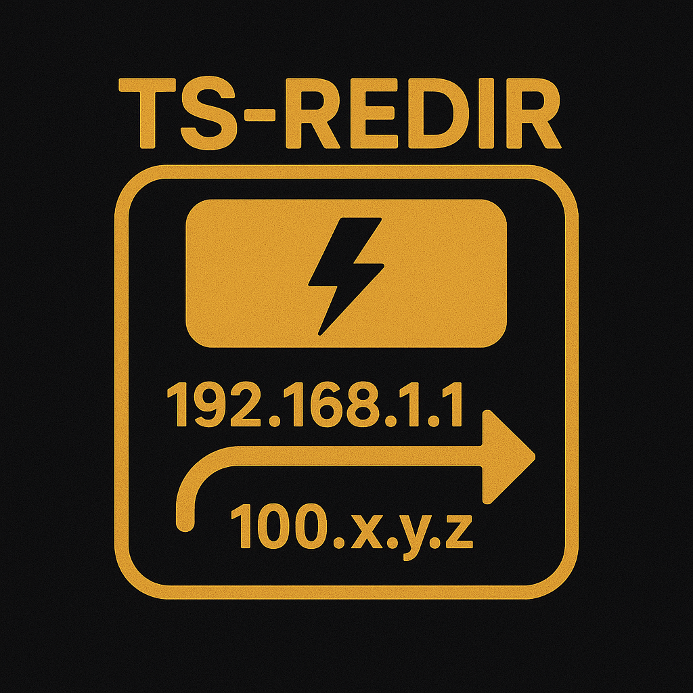
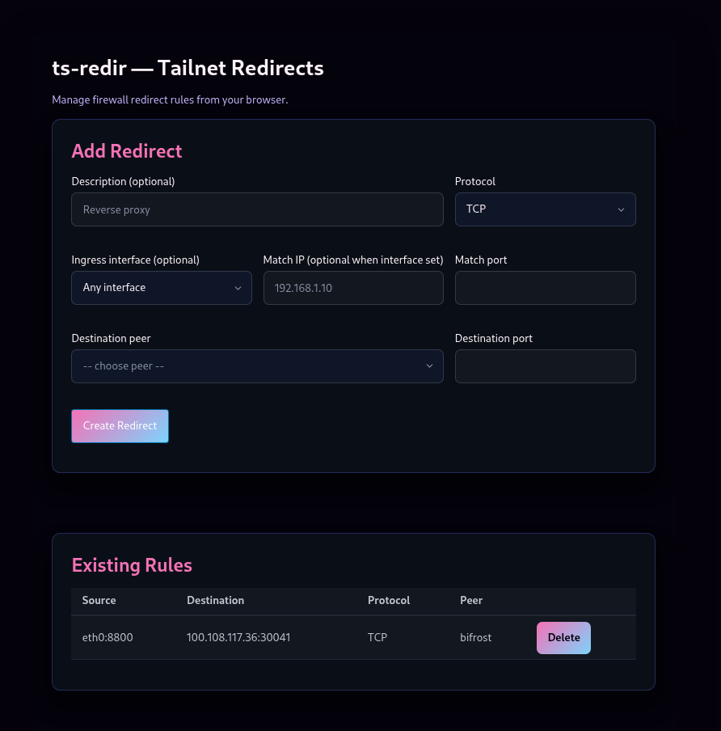
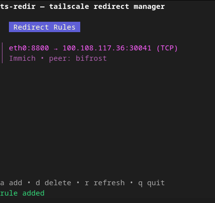

# ts-redir

`ts-redir` is a terminal user interface for managing firewall redirect rules that forward traffic into a Tailscale tailnet. It combines various firewall libraries with the Bubble Tea framework or web-ui to provide an interactive workflow for creating and deleting DNAT rules that point traffic at Tailscale peers. Current support includes `nftables` on Linux and `netsh interface portproxy` on Windows. More firewalls such as pfctl on macOS coming soon. Feel free to create an issue if you want particular firewall support.

## Disclaimer

This project is not affiliated with Tailscale the company. This is a personal project that I have been developing in order to solve a problem I sometimes have.

## Interface

### Web Interface

You can run with `sudo ts-redir --web --ts-interface tailscale0 --port 8800`. By specifying the ts-interface you can gaurentee that no other interface can reach the web interface to control firewall rules.



### TUI Interface

You can run with `sudo ts-redir`



## Reasoning

I have found myself from time to time wanting to use my tailnet not for the subnet routing feature but in the reverse direction. To be able to direct non-tailnet traffic into my tailnet. While Tailscale Funnel can do this, I don't necessarily want it public and would prefer a generic ip forwarding rule instead of a full reverse-proxy. By forwarding traffic into the tailnet as a router might, I am able to have a device (such as a raspberry pi) sit on a LAN but be able to proxy traffic over a tailnet. By doing so, no other devices on that LAN technically need to have tailscale installed in order to proxy traffic over the tailnet that exposes a port on the device.

## Features

- Discover Tailscale peers via the local `tailscale status --json` command.
- Create IPv4 DNAT rules that match a destination IP/port (optionally scoped to a specific ingress interface) and forward them to a peer/port, with automatic postrouting masquerade so return traffic reaches the client.
- List and remove existing rules that were created through the application.
- Automatically ensures the `ip ts_redir` table and `prerouting`, `postrouting`, and `output` chains exist.
- On Linux, select **Both (TCP + UDP)** to create matching TCP and UDP redirects in one operation. They appear as separate rules and can be deleted independently. If either matching rule already exists, neither rule is added.
- On Windows, the terminal and web interfaces offer **TCP only**. The API and firewall backend also reject UDP and combined-protocol requests because `netsh portproxy` does not support UDP.

The web API accepts `"protocol": "both"` in `POST /api/rules` on Linux. The resulting rule list contains separate `"tcp"` and `"udp"` entries. Windows accepts only `"tcp"` and returns HTTP 400 for other protocols.

## Requirements

- Linux host with nftables support and privileges to add NAT rules (typically root).
- Windows host with Administrator privileges and the built-in `netsh interface portproxy` available for TCP redirection. UDP traffic forwarding remains unsupported on Windows. The built-in DNS server itself supports both UDP and TCP.
- Tailscale CLI installed and authenticated (for peer discovery).
- ip_forwarding enabled on the Linux host.
    - `sudo sysctl net.ipv4.ip_forward=1`
    - For persistent ip forwarding:
        - `echo "net.ipv4.ip_forward=1" | sudo tee -a /etc/sysctl.conf`
- Go 1.24 or newer if building from source.

Redirects created through ts-redir are saved to its configuration file and restored at startup. This also preserves descriptions and peer labels on Windows. Existing rules are adopted into the configuration when you associate a hostname with them; other pre-existing rules are left alone.

## Installation

`go install github.com/apoindevster/ts-redir/cmd/ts-redir@latest`

## Running From Source

The program must access nftables, so you usually need to run it with sufficient privileges (e.g. via `sudo`).

```bash
sudo go run ./cmd/ts-redir/main.go
```

To launch the modern web UI (which only binds to your Tailscale interface), pass `--web`:

```bash
sudo go run ./cmd/ts-redir/main.go --web --ts-interface tailscale0 --port 8080
```

Within the UI:

- `a` — add a new redirect rule
- `d` — delete the selected rule
- `r` — refresh nftables rules
- `q` — quit

Use `ts-redir -version` to print the build metadata that GoReleaser injects into release artifacts.

On Linux, live rules are identified using nftables `UserData`, so only ts-redir rules appear in the list. Windows lists existing netsh portproxy entries.


## Local DNS and reverse proxies

Use the **Local DNS** section of the web UI to make existing service domains
resolve to this machine on your LAN. The browser keeps using the original URL,
so TCP forwarding preserves its TLS SNI and HTTP Host header. The destination
reverse proxy still handles HTTPS and certificates; ts-redir does not terminate
TLS, rewrite HTTP, or provide a public entry point.

For example, with ts-redir at `192.168.1.20` and your tailnet reverse proxy at
`100.64.0.2`:

1. Reserve `192.168.1.20` in DHCP or assign a stable LAN address.
2. Add a **TCP** redirect from `192.168.1.20:443` to `100.64.0.2:443`.
3. Under **Service hostnames**, associate `photos.example.com` and
   `files.example.com` with that redirect. Multiple names share one rule.
4. Select the machine's LAN address under **LAN address for DNS**, enable DNS
   forwarding, and save. Both UDP and TCP port 53 must be available on that IP.
5. Configure the network's **DHCP DNS server** setting to hand out
   `192.168.1.20`, then renew client leases or reconnect clients. Keep the
   gateway's own upstream DNS independent of ts-redir; pointing it back at
   ts-redir can create a forwarding loop.
6. Run **Setup checks**, then test DNS and HTTPS from a separate LAN client.

For HTTP links and HTTP-to-HTTPS redirects, add another TCP redirect on the
same LAN IP from port 80 to the reverse proxy's HTTP port. DNS does not select
ports: ordinary HTTPS URLs require local port 443, and HTTP requires port 80.
Different destinations sharing the same LAN IP and TCP port still require one
reverse proxy to route by hostname. HTTPS certificates must cover the original
service names. Direct IP URLs do not supply the same hostname identity.

The built-in DNS forwarder:

- Answers exact configured names locally with an IPv4 A record and a 30-second
  TTL. Names are case-insensitive; wildcard names are not supported. Enter
  punycode for international domain names.
- Returns an empty successful answer (NODATA) for other record types on those
  exact names, including AAAA and HTTPS/SVCB, so public IPv6 addresses and address
  hints cannot bypass the IPv4 redirect. Other names and subdomains retain their
  upstream answers. These local overrides are unsigned; clients performing
  their own DNSSEC validation need a compatible local policy.
- Discovers upstream DNS from the selected LAN interface and refreshes it every
  30 seconds. Linux uses `resolvectl`, then NetworkManager (`nmcli`), then the
  system resolver files. Windows uses `Get-DnsClientServerAddress`. Resolver
  files can contain a local stub, which must not forward back to ts-redir.
- Excludes its own listener and Tailscale's MagicDNS resolver from upstreams.
  There is no hardcoded public fallback. If discovery or upstream requests fail,
  local overrides still work and other queries return SERVFAIL. When a network
  advertises ts-redir as its only DNS server, the ts-redir host itself needs an
  independent upstream DNS configuration on its LAN adapter.
- Accepts DNS over UDP and TCP, retries truncated upstream responses over TCP,
  and tries another discovered server when a server fails. It forwards ordinary
  DNS requests without adding a cache.

Clients must actually use this DNS server. Public secondary DNS servers, custom
browser DNS-over-HTTPS, VPN DNS, or cached answers can bypass the overrides.
This does not automatically configure routers or client devices. If you cannot
change DHCP, configure DNS on each client or add a hosts-file override there.
Only clients that can reach the configured LAN IP can use it. Allow LAN UDP/TCP
53 plus the redirected ports through the host firewall; Linux also needs IPv4
forwarding and appropriate forward-chain policy. Restrict access to the intended
LAN. HTTP/3 uses UDP and is outside the TCP-only HTTPS setup; clients need TCP
fallback (Windows portproxy remains TCP-only).

**Setup checks** inspect the DNS listener, upstream lookup, saved and live
redirects, Linux IPv4 forwarding, hostname answers, and destination connectivity.
For local port 443 they also verify TLS using the configured hostname and system
certificate trust. These checks run on ts-redir, so a separate LAN-client test
is still needed to verify DHCP, firewall policy, and the complete forwarding path.
The UI remains bound to the selected Tailscale interface, separately from the
LAN DNS listener.

## Persistence and background service

The default configuration is `/etc/ts-redir/config.json` on Linux and
`%ProgramData%\ts-redir\config.json` on Windows. Use `--config PATH` to change it.
Updates use a temporary file and rename; a lock prevents two ts-redir instances
from using the same file. Hostnames reference stable rule identities, so restored
rules can receive new OS handles without breaking their mappings. Remove a rule's
hostname mappings before deleting it. Removing a hostname leaves its shared
redirect in place.

Keep the same configuration file when switching between the TUI, web UI, and
service. Settings and newly created rules are saved immediately; saved rules are
restored on startup and reconciled every 30 seconds. DNS settings also take effect
immediately. After boot, unavailable interfaces/listeners are retried. If the LAN
IP changes, choose its new address explicitly rather than relying on automatic
address substitution. To prevent a saved rule from returning, delete it through
ts-redir instead of editing nftables or netsh directly. Stop ts-redir before
manually editing its configuration.

Build or install the executable in a permanent location before installing a
service; **do not install a service from `go run`**. Stop the foreground instance
before starting the service. The service runs DNS, rule restoration, and the web
UI without a terminal and is configured to start automatically.

Linux (root, systemd):

```bash
go build -o ts-redir ./cmd/ts-redir
sudo install -m 0755 ts-redir /usr/local/bin/ts-redir
sudo /usr/local/bin/ts-redir --service install --ts-interface tailscale0 --port 8080
sudo /usr/local/bin/ts-redir --service start
sudo /usr/local/bin/ts-redir --service status
```

Windows (Administrator PowerShell, using a permanently installed executable):

```powershell
& 'C:\Program Files\ts-redir\ts-redir.exe' --service install --ts-interface Tailscale --port 8080
& 'C:\Program Files\ts-redir\ts-redir.exe' --service start
& 'C:\Program Files\ts-redir\ts-redir.exe' --service status
```

Supported service actions are `install`, `start`, `stop`, `restart`, `status`,
and `uninstall`. Include custom `--config`, `--ts-interface`, and `--port` values
when **installing**, since they are saved in the service definition. Stop the
service before uninstalling it. Uninstalling preserves the configuration and
forwarding rules. `--daemon` runs the same background components in the foreground
for an existing process supervisor. Exiting a foreground session or stopping the
service stops DNS; OS forwarding rules remain until removed or the OS resets them.

## DNS API

The web UI and API share the same saved configuration. New endpoints:

| Method | Path | Purpose |
| --- | --- | --- |
| GET | `/api/lan-addresses` | Available private LAN IPv4 addresses |
| GET | `/api/dns` | Listener settings, hostname mappings, upstreams and runtime errors |
| PUT | `/api/dns` | Save and apply `{"enabled":true,"listen_ip":"192.168.1.20"}` |
| POST | `/api/hostnames` | Add `{"hostname":"photos.example.com","rule_handle":"123"}` |
| DELETE | `/api/hostnames/photos.example.com` | Remove an override, preserving its redirect |
| POST | `/api/diagnostics` | Run bounded setup checks |

`GET /api/rules` now includes `handle_id`, a decimal **string**. Use it as the
`rule_handle` when adding a hostname or in `DELETE /api/rules/{handle_id}`. The
legacy numeric `handle` field remains available, but JavaScript numbers cannot
represent every Windows rule handle accurately. Up to 256 exact hostnames are
supported. DNS is disabled until explicitly enabled; invalid settings or a port
53 collision are rejected without saving the requested change.
